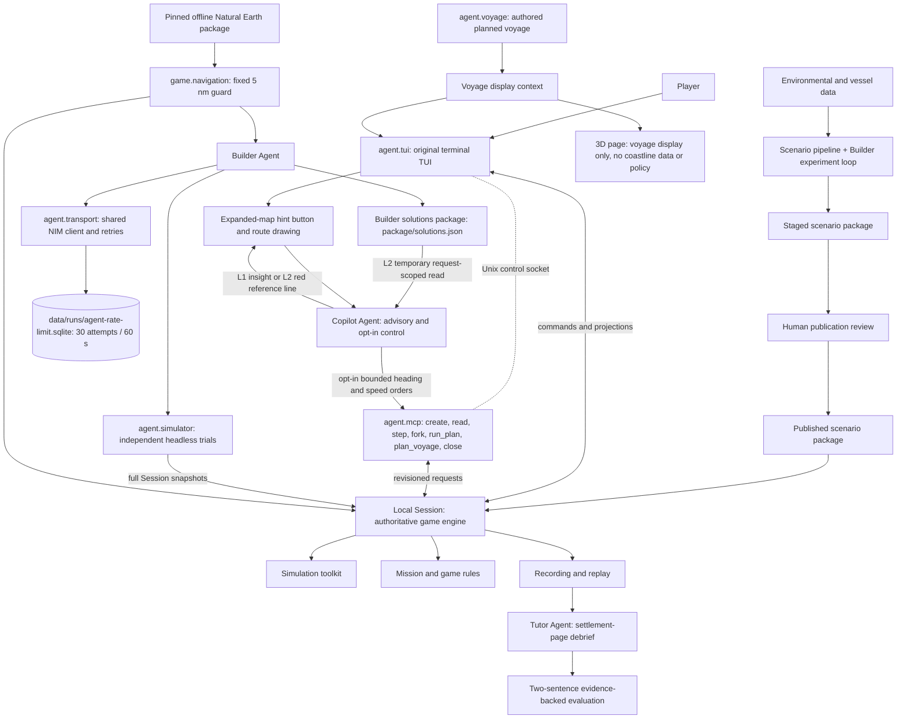

# TIDE Prototype Architecture

This document defines the current prototype and the active coastal-navigation scope through module inputs, actions and outputs. It follows [Product.md](Product.md). The local `Session` is authoritative. The `agent/` package is implemented for the Builder role; Copilot and Tutor are planned. The planned Copilot has advisory L1/L2 modes and an explicitly enabled route-following control mode. Director is retained but disabled at game entrypoints. The core TUI/MCP coast guard and authored voyage source now exists and has focused tests. MCP and Builder integration and the final suite remain with the parent. Real pipeline monitoring remains the priority. This documentation pass defines planned roles only and implements no role runtime. The Agent model transport has a global 30/60 attempt budget; the solutions package contract is [SOLUTIONS.md](SOLUTIONS.md).

## 1. Module Contracts

| Module | Accepts | Performs | Produces |
| --- | --- | --- | --- |
| **Scenario construction** | Environmental data sources, vessel data and designer-fixed mission inputs. | Collects and processes data, finds candidate windows, assembles missions and packages results. The Builder runs a controlled experiment loop over output copies. | A staged or published **scenario package**. |
| **Local Session / game engine** | A scenario package, current state, player commands and revisions. | Validates commands, advances physics, applies cargo and ship rules, records events and enforces immediate stops. | Authoritative state, events, revisions and role-scoped projections. |
| **Agent harness (`agent/`)** | One role profile, a scoped projection and tool results. | Runs one small LangGraph role workflow with explicit tools, evidence and checkpoints. | Role output, tool calls and recorded evidence. |
| **Agent model transport (`agent.transport`, `agent.rate_limit`)** | A model profile, the shared `config/api_keys.local.json` credential file and a request payload. | Uses NVIDIA NIM for active roles. Reserves one global slot before every HTTP attempt, including retries. Enforces 30 attempts in any rolling 60 s through fixed SQLite `data/runs/agent-rate-limit.sqlite`. Fails closed if limiter state is unavailable. | A model message or a sanitized `ModelError`; no keys in errors or the database. |
| **Headless simulator (`agent.simulator`)** | A project-contained scenario, a complete Session snapshot, timed route orders, bounded step calls or a fork request. | Opens, forks and advances independent Sessions. Independent mode does not touch the live Session; attach mode can issue bounded commands to it through MCP. | Trial metrics, events, complete state and role-scoped evidence. |
| **Interaction hosts (`agent.tui`, `agent.mcp`)** | A scenario or live Session, a Unix socket or workspace, and `create`, `read`, `step`, `fork`, `run_plan`, `plan_voyage` or `close` calls. | Hosts the original TUI or attaches MCP to the same Session. Enforces path containment, stale-revision rejection, process-local operation receipts, finite step duration and the shared coast guard. | Terminal control, MCP results, read-only voyage context and independent headless Sessions. There is no batch or cancel RPC. |
| **Coastal navigation guard (`game.navigation`)** | The pinned offline land dataset, a local point or a candidate route edge or segment. | Applies one fixed 5 nautical mile land buffer. Checks candidate edges and actual local execution. Fails closed when data is missing, corrupt or empty. | Safe/unsafe result, distance or buffer evidence and a stable rejection or stopping reason. It never relocates the vessel. |
| **Navigation data preparation (`pipeline.navigation_data`)** | Pinned Natural Earth 10m land v5.1.1 source and its checksum/provenance metadata. | Verifies, stages and prepares the offline `data/navigation` package. Validates scenario initial positions. | Offline navigation artifact, provenance record and validation result. Runtime downloads are forbidden. |
| **Voyage authoring (`agent.voyage`)** | A scenario start and initial heading, the sea-route network and canonical `web/game/ports.json` ports. | Builds an authored plausible voyage by weighted shortest path after snapping the actual start to the nearest network point. Keeps distinct opposite branches oriented by initial heading. | Voyage view with actual start, snap offset, branch, ports and authored provenance. It never changes escape or scoring. |
| **Numerical simulation / physics toolkit** | Vessel state, heading and speed commands, environmental fields, vessel parameters and stopping conditions. | Samples the environment, calculates movement and response, accumulates exposure and detects events. | Updated vessel state, a trajectory segment, response and exposure metrics, and a stopping reason. |
| **Mission and game rules** | Mission settings, simulation results, elapsed time and accumulated game state. | Maps exposure to game cargo loss, tracks progress and checks objectives and limits. | Updated game metrics and mission events, such as escape or timeout. |
| **Copilot Agent (planned)** | A learner hint request, the complete currently released forecast payload for the scenario and valid window, visible vessel state, a temporary request-scoped solutions view, a learner-drawn route and an explicit control grant. | Runs L1 brief advice with no solutions access. Runs L2 route selection with a temporary request-scoped permission. In opt-in control mode, uses a deterministic local controller and bounded authoritative tools to track a desired route. Distinguishes dataset historical truth from a simulator-derived issued forecast. | A brief insight, a `route_id` with red reference-line waypoints, or bounded heading/speed orders. Advisory modes never steer. Control needs an explicit grant and never edits rules or scores. |
| **Solutions package (`package/solutions.json`)** | Every distinct qualified final trial, its timed orders, sampled track, actual metrics and fingerprint metadata. | Writes one readable summary, reading guide and route list. Omits failed alternatives and reports them. Keeps bulky logs in trial directories. | A factual route package with solver, orders, actual sampled track, time, loss, ship result, limits and provenance. It does not claim full enumeration. |
| **Tutor Agent (planned)** | The terminal game log, settlement record, commands, events and recorded outcome. | Evaluates decision quality with concise evidence from the real log. | A two-sentence settlement-page evaluation with cited facts, no fabricated outcome and no rule or score changes. |
| **Player interface** | Visible state, environmental information, checkpoints and Agent responses. | Displays the map, instruments and mission status. Collects controls, hint requests, route drawing, control grants and pause/resume requests. | Player actions and interaction requests. |

Local code performs data processing, numerical calculations, rule evaluation, state storage and logging. Agents invoke these capabilities through scoped tools. The local Session remains authoritative; an Agent cannot calculate or commit a physical result directly.

## 2. Main Connections

The local Session owns game-flow execution and authoritative state. Local tools validate calls, commit computed state and handle immediate pause requests. A separate Session Controller is unnecessary. Agent roles are scoped clients; they do not become a second game engine. The Builder writes a package for review only and never publishes.

## 3. Shared Inputs and Results

| Object | Contents |
| --- | --- |
| **Scenario package** | Area and historical time window, environmental fields, information-release times, vessel model and loading condition, initial state, fixed seed and checksums. |
| **Builder candidate** | Method family, baseline or adaptation identity, route orders, settings changed only in the output copy, full-Session result and rejection reason. |
| **Headless trial** | A full Session snapshot or scenario copy, finite timed route orders or bounded step calls, seed, compute limit and trial lifetime. |
| **MCP request** | `trial_id`, expected revision and bounded arguments for a `create`, `read`, `step`, `fork`, `run_plan`, `plan_voyage` or `close` call. A step also carries a nonempty `operation_id`; `plan_voyage` accepts only a project-contained scenario path and starts no trial. |
| **Player action** | Two parameters: target heading and speed. Local controls use this format. An opt-in Copilot control grant may issue the same bounded action through authoritative tools. Advisory modes never issue it. |
| **Copilot request** | Request id, advisory mode (L1 or L2), scenario and valid window, visible vessel state, released forecast payload and a temporary permission scope. L1 has no solutions access. L2 receives a request-scoped solutions view and returns a route id. |
| **Steering grant** | Explicit learner grant for route following, desired route, per-step bounds, controller rule version, expected source and revision, and an immediate revoke or pause path. |
| **Tutor evaluation** | Two short sentences derived from the terminal game log, with cited real facts, one key decision, one improvement and a deterministic fallback when evidence is missing. |
| **Game state** | Simulation time, vessel position and motion, active command, accumulated exposure, game cargo status and mission progress. |
| **Advance result** | New state, trajectory segment, calculated metrics, events and the reason simulation stopped. |
| **Checkpoint** | A request for a decision, accompanied by visible state, relevant evidence and the reason for interruption. |
| **Navigation data package** | Pinned Natural Earth 10m land v5.1.1 source, SHA-256 checksums, licence/attribution, prepared offline artifact and the fixed 5 nm guard identity. |
| **Voyage view** | Authored planned route, actual start, nearest network point, snap offset in nautical miles, initial heading, selected branch, ports and provenance label. It is display context, not an escape condition. |
| **Solutions package** | One readable `solutions.json` with a purpose and reading guide, fixed initial conditions, final budget, source fingerprint, minimum and found counts, and every distinct qualified route: solver, all timed orders, actual sampled track when available, actual escape time, TEU loss, ship result, limits and full-trial provenance. Failed final revalidations are omitted and reported. |

These are conceptual contracts, not a finalized API schema. Local code maintains authoritative state; Agent text does not substitute for calculated state updates. Each role receives only its permitted projection.

## 4. Runtime Loop

1. The local Session loads a scenario package and initializes authoritative state.
2. `agent.tui` presents the briefing and available information through the original terminal interface. `agent.mcp` may read the same Session or own an independent headless workspace.
3. The player submits target heading and speed through local controls, requests L1 or L2 advice from the expanded-map hint button, or draws a route, previews it and grants opt-in route following.
4. L1 reads the complete currently released forecast payload and visible state, with no solutions access. L2 receives a temporary request-scoped solutions permission and selects a reference route. Advisory output is an insight or a red reference line, never a command. A control order passes through bounded MCP tools.
5. The Session validates a direct action or a control order against vessel capability, geographic bounds, the fixed 5 nm coast guard and scenario permissions.
6. Simulation advances locally until an event, action completion, manual pause or maximum advance interval. Actual local execution checks the coast guard through `game.navigation` before an unsafe position is committed. It returns state, metrics and a stopping reason.
7. Game rules update cargo loss and mission progress. The Session records the new state and events. In control mode, every step checks the source and revision, and a human pause or order overrides the controller immediately.
8. The player keeps or changes the command and resumes. The TUI or MCP reads the new revision and receives a role-scoped projection.
9. Builder candidates and other permitted role experiments use full Session snapshots through the simulator's independent mode; they do not move the live vessel.
10. The loop continues until mission completion or an outcome stop. Recording and replay produce the evidence for the planned Tutor debrief.

Event detection runs in local code, without an Agent call at every numerical step. A game-rule limit that requires an immediate stop is also evaluated locally during advancement. A repeated MCP step with the same process-local operation id returns its recorded commit; a conflict or stale revision is rejected. A fork is isolated from the live Session. There is no batch or cancel RPC: close, human pause, finite step duration and process shutdown bound execution.

## 5. Essential Boundaries

### 5.1 Coastal navigation and voyage separation

The local TUI and MCP are the primary safety surfaces. The 3D page is not a navigation authority and must not load, render or evaluate coastline data.

`game/navigation.py` is the only authoritative guard. It uses one fixed 5 nm offset and the offline pinned Natural Earth package. Route candidate checks and actual Session advancement both call it. A candidate that touches or crosses the buffer is rejected before trials. Actual execution stops or rejects before committing an unsafe position. The committed state is not relocated. Data load failure is a hard local failure, not a fallback to open water.

`pipeline/navigation_data.py` prepares and verifies the offline package. `agent/voyage.py` builds the separate authored voyage. The voyage starts from the actual vessel position, snaps through the nearest network point, records the offset, keeps distinct opposite branches and orients them by the initial heading. It is labelled plausible authored context, not a historical log. Port approach is display context only.

The core local implementation is now tested. Peer handoff reported 22 navigation/voyage/live Python tests passed in 2.37 s; a docs-time rerun passed 23 in 4.01 s. Node reported 37 passed; a docs-time `node --test game.test.js` also passed 37. A real TUI Menorca short play remained outside the 5 nm guard for 70 s. The data verify-only command succeeded with SHA-256 `e547d749445eaa0964aba76738090ec88f5e63c4585122170f98c67a7ea922dc`. The actual Biscay 20260123 voyage is Brest to Vigo, 612.34 nm, 11.37 nm snap offset and 22 authored points. MCP and Builder integration peers are still active, so their acceptance remains with the parent.

Acceptance requires tests for dataset corruption, unsafe and boundary points, unsafe candidate edges, unsafe actual advancement, unsafe initial state, opposite branches, snap offset, start preservation, missing voyage compatibility and the absence of 3D coastline policy. The parent records the final suite after all source owners finish.

### 5.2 General boundaries

- **Fixed environment, changing trajectory.** Historical fields remain fixed. Actions change where and when the vessel encounters them.
- **Execution and calculation.** The local Session validates requests, advances simulation and commits state. Agents select scoped tool calls; they do not replace numerical calculations.
- **Builder inputs and outputs.** A designer fixes initial time and state, environment and region, physics, damage model and seed. The Builder calibrates only the budget, end timestamp and derived schedules in an output copy; the escape condition remains fixed. It never edits fixed inputs or overwrites a published package.
- **Builder qualification.** A route qualifies only when it escapes, the ship survives and at least 99% of total TEU remains. A full Session is the only proof. TopTier is a risk reference, not a pathfinder. Game scoring, judgement and star rules remain unchanged; there is no zero-loss or 95% deck-retention test.
- **Publication.** The Builder stages scenario, gameplay, validation, solutions and report material. Human review is mandatory before publication, with versions and checksums including the simulation implementation.
- **Information access.** The terminal and MCP receive released information. Copilot L1 receives the complete currently released forecast payload for the scenario and valid window plus the current visible vessel state, with no solutions access. The full forecast is available through a tool or chunked retrieval. L2 receives a temporary request-scoped solutions view and cannot access raw hidden future grids. The full package must not enter every learner conversation or pass directly to the frontend. The frontend receives only the selected route id, reference waypoints and red reference line.
- **Solutions package and Copilot.** `package/solutions.json` is one readable route file. It stores every distinct qualified route discovered within the finite compute budget and revalidated against the final scenario. The default minimum is three routes, set by `--min-solutions`; there is no storage cap. If fewer than the minimum pass, the package is `pending` and the valid routes are preserved. Slower alternatives must also pass inside the final budget. The file does not promise that all possible routes are enumerated. The planned Copilot L2 grants a temporary, request-scoped read permission and selects a suitable reference route from position, time, heading, speed, remaining budget, damage and current-source fingerprint. It returns a route id, reference waypoints, a red line and a short insight. The permission is revoked after the request, no persistent solution prompt remains, and L2 makes no guarantee for an arbitrary current state. L1 and L2 are advisory only. The L2 permission is request-scoped and is not a graded-hint permission or hint charge.
- **Opt-in route following.** The learner may draw a route, preview it and explicitly grant control. The planned controller uses deterministic local path following, verified response tables and fast scientific lookups from actual motion, wave-relative heading, roll/pitch response, cargo and ship load metrics, speed-dependent manoeuvring, steering/rpm limits and sea, coast, environment, time and cargo constraints. It does not let the model invent physics or assume that slower is always safer. Orders pass through bounded authoritative Session/TUI MCP tools with per-step bounds, source and revision checks, immediate human pause or order override and outcome stops. It never edits rules, scores or recorded outcomes. Calibration requires a few full-speed forked TUI/MCP trials, held-out comparison and a frozen versioned rule document. No runtime or calibration exists yet.
- **Tutor.** The planned Tutor reads the terminal game log and shows a simple settlement-page evaluation, by default two short sentences with one key decision and one improvement. It cites real facts and does not fabricate an outcome. It cannot change rules, scores, judgement, stars, cargo totals or the recorded outcome.
- **Trials and execution.** Independent trial mode uses a full Session or a complete fork. It reuses calculation tools without moving the live vessel. A fork preserves motion, wave phase, controller, exposure, cargo, ship, consumed events, order, seed and revision.
- **MCP authority.** MCP controls the same Session as the original TUI or an independent headless workspace. It does not own browser checkpoints or scores. Stale revision, process-local idempotency and finite-duration limits apply. Batch, cancel and command-revision RPCs are not implemented.
- **Coast guard.** TUI and MCP use one fixed 5 nm land buffer from offline pinned Natural Earth 10m land v5.1.1 data. Candidate edges and actual local execution share `game.navigation`. Missing, corrupt or empty data fails closed. An unsafe initial state is a Builder `pending` result or a clear local startup error; the start is never moved.
- **Voyage context.** A scenario authors a plausible voyage from the sea-route network and canonical ports. The actual start is preserved and the snap offset is reported. The voyage and port approach never change escape, qualification or score. The 3D page may display backend voyage context but contains no coastline data or navigation policy.
- **Agent status.** Builder is implemented. Copilot and Tutor runtime remain unimplemented; their design is documented here and in [PLAN.md](../PLAN.md#715-planned-copilot-and-tutor-scope-documentation-only-handoff). Director remains retained but disabled. No current Biscay package has a qualified route, and no second playable scenario is published. The solutions package is implemented; 57 Builder/budget/context checks and 12 exporter checks passed.
- **Physical and game metrics.** An explicit rule maps response or exposure to game cargo loss. This is not a validated prediction of real container failure.
- **Extensibility.** New scenarios and improved models reuse the contracts. Agents can only request capabilities supported by available tools.

## 6. Shared Agent Model Access and Attempt Budget

Active application Agents use the same ignored `config/api_keys.local.json` credential file and NVIDIA NIM. The Builder role is `builder_nim` with model `nvidia/nemotron-3.5-lightning-30b-a3b`. The retained Director imports the same transport through `game/director/models.py`, but its entrypoints remain disabled. Copilot and Tutor runtime is planned; any future role call must use this transport and the fixed 30/60 budget.

`agent.rate_limit` owns one fixed policy:

1. At most 30 actual model HTTP attempts may start in any rolling 60 seconds.
2. The budget covers every role, client, thread and process in the project.
3. The store is `data/runs/agent-rate-limit.sqlite` and contains timestamps only.
4. Profiles, tools and command-line options cannot raise the cap or choose another database.
5. Every retry reserves another slot. A model call makes at most three HTTP attempts.
6. If the store is unavailable, the transport fails closed before HTTP.

`agent.transport.ChatClient` reserves a slot before each POST. Network errors retry after 1 s and 2 s. HTTP 429 and 5xx use a bounded `Retry-After` value or the same backoff. Other HTTP errors and malformed responses raise a sanitized error. Local MCP tools, physics, navigation, route search and voyage planning do not call the limiter and do not consume model budget.

Current evidence: `tests/test_agent_rate_limit.py` has 12 focused tests that pass, including the 31st-attempt wait, rolling-window behaviour, retries consuming slots, shared clients/threads/profiles, fail-closed limiter failure and fixed NIM Builder profile. The lock-timing and separate-process acceptance tests pass. No live provider call is recorded.
