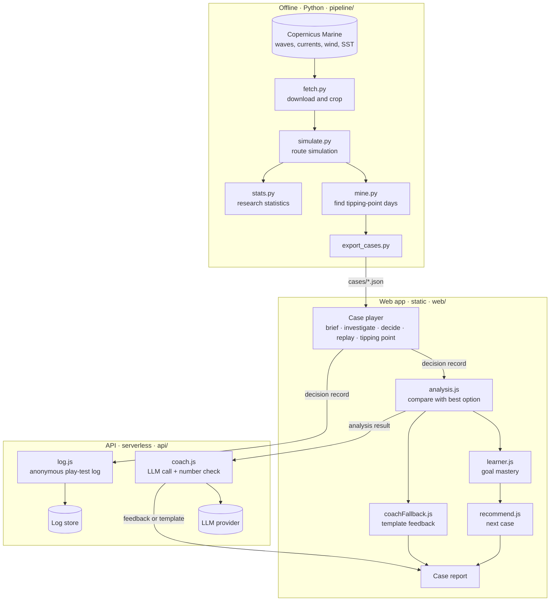

# Architecture

SeaSense has three parts: an offline **pipeline** that turns Copernicus Marine data into case files, a static **web app** that plays the cases and analyses each decision, and a small **API** that phrases coach feedback and stores anonymous play-test logs. Data formats between the parts are defined in [`SCHEMA.md`](SCHEMA.md).

## Design principles

1. **Facts come from code, never from the language model.** Sea states, risks, tipping points and recommendations are computed deterministically. The AI coach only phrases an analysis result it is given, and every number it writes is checked against that input.
2. **Every case is a real day.** Cases are selected from historical data by a documented rule, not written by hand. A case that does not show an interesting decision is dropped, not edited.
3. **The product works without the AI.** If the coach call fails or times out, the app shows template feedback built from the same analysis result.
4. **Precompute everything that can be precomputed.** The web app reads static JSON. No Copernicus request happens while a student plays.
5. **No personal data.** Play-test logs use a random session id and contain decisions only.

## Overview

## Components

| Component | Responsibility | Input | Output | Runs |
|---|---|---|---|---|
| `pipeline/fetch.py` | Download Copernicus Marine products for the case area and period, crop to a box around the routes | Product and dataset IDs, bounding box, dates | Local NetCDF files in `data/raw/` (not committed) | Offline |
| `pipeline/simulate.py` | Move a vessel along a route over time; classify head, beam and following seas; apply current; count hours over limits | Route points, departure, sea-state lookup, limits | Simulation result per route and departure | Offline |
| `pipeline/mine.py` | Simulate every day × departure × route; keep days where the best route changes with departure time | Simulation results | Candidate case days with their tipping points | Offline |
| `pipeline/export_cases.py` | Write the selected days as case files | Candidate days, gridded data | `web/public/cases/<id>.json` | Offline |
| `pipeline/stats.py` | Summary statistics for the pitch, e.g. share of days when the shortest route is not the best | Mining results | Numbers for `docs/METHODS.md` | Offline |
| Case player | The seven screens: case library, briefing, investigation, decision, replay, tipping point, report | Case file | Decision record | Browser |
| `analysis.js` | Compare the decision with the best option at the same departure; find missed key evidence and the weak learning goal | Case file, decision record | Analysis result | Browser |
| `learner.js` | Keep mastery per learning goal across cases | Analysis results | Learner profile (local storage) | Browser |
| `recommend.js` | Pick the next unplayed case that targets the weakest goal | Learner profile, case index | Next case id | Browser |
| `coachFallback.js` | Build feedback text from the analysis result without AI | Analysis result | Feedback text | Browser |
| `api/coach.js` | Ask the LLM to phrase the analysis result; reject output whose numbers are not in the input | Analysis result | Coach response | Serverless |
| `api/log.js` | Store anonymous decision records for play-test analysis | Decision record | Stored row | Serverless |

## Data flow for one case

1. The player loads `cases/<id>.json`.
2. During investigation the student opens up to three evidence layers. The map shows the forecast grid if the case has one, otherwise the analysis grid up to the departure time.
3. On submit, the player creates a decision record and sends it to `api/log` (fire and forget).
4. Replay and the tipping-point screen read the precomputed `sims` and `flips` from the case file.
5. `analysis.js` builds the analysis result. `learner.js` updates the profile and `recommend.js` picks the next case.
6. The report shows template feedback immediately, then replaces it with the coach response if `api/coach` answers within the timeout.

## AI coach

- **Input**: the analysis result only. No raw sea-state data, no free-form chat.
- **Instructions**: respond to the student's own reasons, name the missed evidence, explain the risk, state when the decision should have been reconsidered, point to the next case. Use only numbers present in the input. About 120 words.
- **Output**: JSON with `feedback` and `numbers_used`.
- **Check**: extract every number and time from `feedback`; if any is missing from the input, or the call exceeds the timeout, return the template text with `source: "template"`.
- **Cost**: one call per finished case.

## Deployment

| Part | Where | Notes |
|---|---|---|
| Web app and case files | Static hosting (e.g. Vercel or GitHub Pages) | Case files ship with the site |
| API | Serverless functions next to the web app | LLM API key in the platform's environment variables, never in the repo |
| Log store | A single table in a hosted database or key-value store | Session id and decision fields only |
| Pipeline | A team member's machine | Copernicus credentials stay local via `copernicusmarine login` |

## Known limits

- **Coastal resolution.** Regional Copernicus products resolve the open channel but not harbours and bays. Simulation covers open-water legs only; harbour approach and exit are not assessed.
- **Forecast versus analysis.** If issued forecasts for past days are not available, the investigation step uses analysis data up to departure time. This is a simplification and is stated in `docs/METHODS.md`.
- **Vessel model.** Speed is constant through the water plus the current component along the heading. Wave-induced speed loss is added only if a published formula is used and cited.
- **Thresholds.** Beam-sea and wave-height limits must cite a published seamanship source. Until then, the prototype labels them as illustrative.

## Open decisions

- LLM provider for the coach.
- Hosting platform and log store.
- Whether archived forecasts are available for the chosen product, which decides how the investigation step works.
