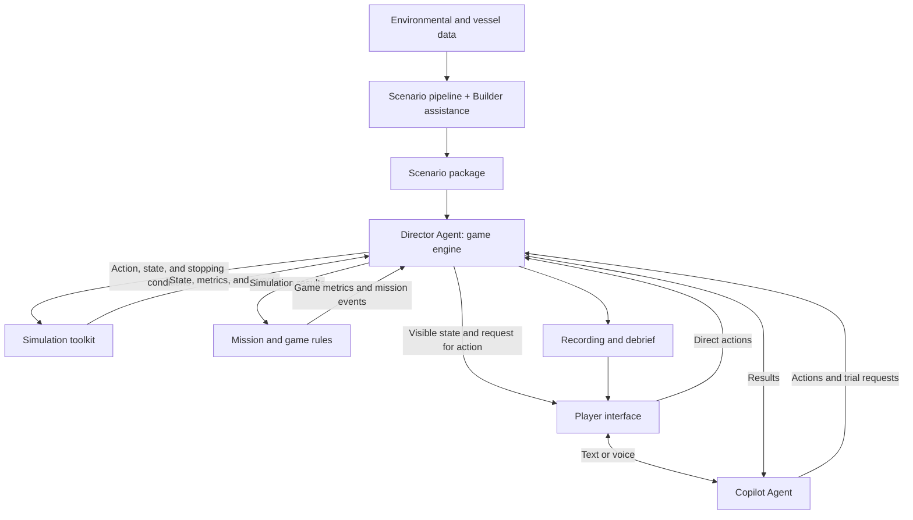

# TIDE Prototype Architecture

This document defines the target prototype through module inputs, actions, and outputs. It follows [Product.md](Product.md); 

## 1. Module Contracts

| Module | Accepts | Performs | Produces |
| --- | --- | --- | --- |
| **Scenario construction** | Environmental data sources, vessel data, and mission requirements. | Collects and processes data, finds candidate windows, assembles missions, runs trials, and packages results. A Scenario Builder Agent assists with interpretation, review, and briefing preparation. | A versioned **scenario package**. |
| **Game engine: Orchestrator / Director Agent** | A scenario package, current state, player actions, and tool results. | Loads the mission, invokes validation and simulation tools, receives events, presents results, and requests the next action. | Game progression, tool calls, checkpoints, and mission completion. |
| **Numerical simulation / physics toolkit** | Vessel state, heading and speed commands, environmental fields, vessel parameters, and stopping conditions. | Samples the environment, calculates movement and response, accumulates exposure, and detects events. | Updated vessel state, a trajectory segment, response and exposure metrics, and a stopping reason. |
| **Mission and game rules** | Mission settings, simulation results, elapsed time, and accumulated game state. | Maps exposure to game cargo loss, tracks progress, and checks objectives and limits. | Updated game metrics and mission events, such as escape or timeout. |
| **Copilot Agent** | Player text or voice input, permitted information, and assistance settings. | Converts intent into executable heading and speed commands or a bounded motion plan.  | Structured actions |
| **Player interface** | Visible state, environmental information, checkpoints, and Agent responses. | Displays the map, instruments, and mission status. Collects controls, natural-language input, and pause/resume requests. | Player actions and interaction requests. |

Local code performs data processing, numerical calculations, rule evaluation, state storage, and logging. Agents invoke these capabilities.

## 2. Main Connections

The Director owns game-flow decisions. Local execution functions validate calls, commit computed state, and handle immediate pause requests. A separate Session Controller is unnecessary; any retained controller is a thin execution layer.

## 3. Shared Inputs and Results

| Object | Contents |
| --- | --- |
| **Scenario package** | Area and historical time window, environmental fields, information-release times, vessel model and loading condition, initial state |
| **Player action** | Two parameter: Target heading and speed. Controls and Copilot output use the same format. |
| **Game state** | Simulation time, vessel position and motion, active command, accumulated exposure, game cargo status, and mission progress. |
| **Advance result** | New state, trajectory segment, calculated metrics, events, and the reason simulation stopped. |
| **Checkpoint** | A request for a decision, accompanied by visible state, relevant evidence, and the reason for interruption. |

These are conceptual contracts, not a finalized API schema. Local code maintains authoritative state; Agent text does not substitute for calculated state updates.

## 4. Runtime Loop

1. The Director loads a scenario package and initializes state through local functions.
2. The interface presents the briefing and available information. The player submits an action directly or through the Copilot.
3. The Director calls validation tools and invokes simulation with the accepted action and stopping conditions.
4. Simulation advances locally until an event, action completion, manual pause, or maximum advance interval. It returns state, metrics, and a stopping reason.
5. The Director invokes game rules to update cargo loss and mission progress, then records the results.
6. The Director presents the decision context and requests an action. Where the active plan permits continuation, it can invoke another advance segment.
7. The loop continues until mission completion. Recording and debrief produce the replay and report.

Event detection runs in local code, without an Agent call at every numerical step. A game-rule limit that requires an immediate stop is also evaluated locally during advancement.

## 5. Essential Boundaries

- **Fixed environment, changing trajectory.** Historical fields remain fixed. Actions change where and when the vessel encounters them.
- **Orchestration and calculation.** The Director selects tool calls and progression. Tools calculate motion, exposure, and game outcomes.
- **Information access.** The interface and Copilot receive released information. Recommendations cannot use hidden future reconstruction.
- **Trials and execution.** Trials use a copy of state. They reuse calculation tools without moving the live vessel.
- **Physical and game metrics.** An explicit rule maps response or exposure to game cargo loss. This is not a validated prediction of real container failure.
- **Extensibility.** New scenarios and improved models reuse the contracts. Agents can only request capabilities supported by available tools.
