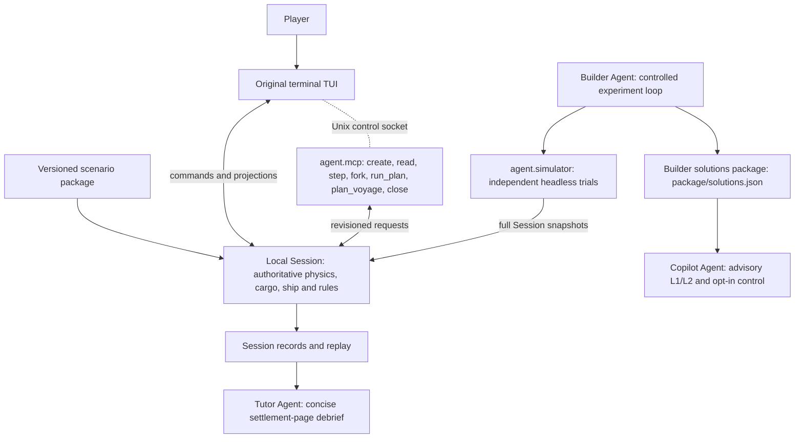

# TIDE: An Agent-Orchestrated Maritime Training Game

## 1. Product Description

### 1.1 Core experience

TIDE is a scenario-based maritime training game. The learner acts as the captain of a specified vessel in a historical marine environment. The learner observes available evidence, adjusts heading and speed, monitors the consequences, and revises the plan as conditions change.

The first mission is **to leave an adverse sea-state region while controlling journey time and game cargo loss**. A continuous vessel state connects successive decisions. The player's actions determine the subsequent trajectory and exposure. The system therefore calculates consequences during play instead of selecting a prewritten branch or marking a single route answer.

The intended experience follows the scenario structure of tactical simulation games: a mission briefing, a bounded operating area, a modelled platform, changing information, meaningful decisions, and a mission outcome. TIDE adapts that structure to maritime observation and decision-making.

### 1.2 Intended learners and educational purpose

The initial audience is deck-officer cadets and nautical-science students who have completed basic navigation, marine meteorology, and introductory ship-stability instruction. 

The exercise targets the application of knowledge:

- Relate wave height, direction, period, and wave systems to the specified vessel and its operating state.
- Distinguish heading, course over ground, speed through water, and speed over ground.
- Identify which information was available at a decision time and whether it needs updating.
- Compare alternative actions and explain their consequences and limitations.
- Monitor the developing situation and revise an earlier decision when appropriate.

[IMO A.893(21)](https://wwwcdn.imo.org/localresources/en/KnowledgeCentre/IndexofIMOResolutions/AssemblyDocuments/A.893%2821%29.pdf) establishes appraisal, planning, execution, and monitoring as connected voyage-planning activities. TIDE concentrates on execution and monitoring, with a briefing and initial plan supplying the earlier context. [IMO MSC.1/Circ.1228](https://wwwcdn.imo.org/localresources/en/OurWork/Safety/Documents/Stability/MSC.1-CIRC.1228.pdf) connects adverse-weather decisions to vessel characteristics, speed, and wave conditions.

### 1.3 Initial scope and success conditions

The prototype uses the S175 motion model with one fixed loading condition and a full-load game cargo template. The template should resemble a plausible container ship without reproducing an exact S175 stowage plan. Loading is not player-configurable in this prototype.

The first release should provide:

1. One  historical adverse-weather window.
2. One fixed vessel loading condition and a documented operating envelope.
3. Continuous movement with heading and speed commands.
4. Manual pauses and event-triggered decision checkpoints.
5. A replay and debrief that trace consequences back to decisions and evidence.
6. A planned Copilot with two modes: on-demand advisory assistance and an explicitly enabled route-following control mode.

The scenario defines an escape objective, a time budget, and an interpretable cargo-loss mapping. The objective must reward progress as well as exposure reduction. Waiting indefinitely or always using maximum speed must not become a trivial winning strategy.

Escape means leaving the scenario's whole, time-varying adverse-weather region and entering valid waters outside it. A low-wave pocket inside the region does not count. Scenario authors derive and review the region from historical fields before publication; its boundary and completion criteria remain hidden during play. The region follows the frozen environmental timeline, so slower progress can expose the ship to an expanding region.

Escape and cargo loss are assessed separately. Cargo loss does not end the mission; the player can continue trying to escape within the time budget. Cargo grade thresholds remain to be calibrated through worked scenarios.

A scenario-authored planned voyage and port approach are display context, not escape conditions. The local coast guard keeps the vessel 5 nautical miles from land. It is separate from the voyage display and never changes the escape rule.

The current delivery covers local game rules, events, terminal play, the web frontend and the dedicated `agent/` package. That package provides a shared role-scoped harness, a simulator and MCP adapter, a terminal host for the same local `Session`, and a controlled Builder. The Builder writes one readable `package/solutions.json` with the distinct qualified routes that it discovered. See [SOLUTIONS.md](SOLUTIONS.md). Builder AI mode is implemented and tested with injected transports; it is not live-verified against a real provider. No current Biscay package has a qualified route, and no second playable scenario has been published.

Director entrypoints remain disabled (2026-10-30; see [PLAN.md](../PLAN.md#7-agentic-systems)); its historical implementation and model configuration are retained. Copilot advisory L1/L2 and the Tutor debrief are implemented on the 3D live page. The Copilot has two advisory modes: L1 uses released forecast data; L2 uses temporary request-scoped access to reference routes. The opt-in route-following control mode remains planned. Both advisory modes are advice only. The control mode is advanced steering assistance that the learner must explicitly enable, preview and start. The Agent architecture below describes the implemented Builder path, the implemented Copilot advisory modes and Tutor debrief, and the planned route-following control and steering calibration. Real pipeline monitoring remains the priority.

## 2. Data Sources and Scenario Construction

### 2.1 Three kinds of scenario content

| Content | Meaning | Who may change it? |
| --- | --- | --- |
| Historical environmental reconstruction | Versioned ocean and weather fields for the selected place and period. | Data preparation, before the scenario is published. |
| Authored mission content | Objectives, briefing, instructional prompts, and game rules. | Scenario authors and constrained Agents, within the published rules. |

The weather timeline remains fixed during a session. The player's route through that timeline does not. This distinction provides replayability.

### 2.2 Environmental inputs

| Source or input | Role in the game |   |
| --- | --- | --- |
| Copernicus wave fields | Supply significant wave height, direction, period, and available wind-sea and swell components. |  |
| Copernicus surface-current vectors | Affect position, course over ground, and passage time. |  |
| Appropriate meteorological forecasts | Supply wind and, when needed, gusts, pressure, visibility, or other mission inputs. |  |
| Official marine bulletins, such as AEMET | Provide professional forecast language, warnings, and regional context. |   |

The approximately 4 km regional ocean grid supports bounded open-water exercises. 

Players receive local sea-state observations, their own cargo status, and weather reports for their current and neighbouring sea areas at defined simulation times. Reports carry issue and validity times. Issue time determines when a report becomes available. Pure local mode delivers reports on the fixed issue schedule. Where historical forecasts are unavailable, the prototype may use forecasts authored offline from historical fields and explicitly labelled as game simulations. These reports are distinct from official historical forecasts; unreleased future fields remain hidden. Copilot L1 receives only the complete currently released payload for the scenario and valid window. It must label dataset historical truth separately from an issued forecast when the forecast is simulator-derived.

### 2.3 Vessel reference package

The leading candidate is the **S175 container-ship dataset in the Marine Systems Simulator (MSS)**. Its [ShipX input report](https://github.com/cybergalactic/MSS/blob/master/HYDRO/vessels_shipx/s175/input.hyd) specifies a 175 m length between perpendiculars, 25.4 m breadth, 9.5 m draft, and a design-waterline loading condition. The [dataset directory](https://github.com/cybergalactic/MSS/tree/master/HYDRO/vessels_shipx/s175) includes hydrodynamic outputs and transfer-function data. MSS provides a [six-degree-of-freedom vessel model](https://github.com/cybergalactic/MSS/blob/master/CRAFT/hydroVessel.m) and a [simulation example](https://github.com/cybergalactic/MSS/blob/master/CRAFT/SIMhydroVessel.m). This is a candidate foundation for one consistent teaching vessel.

### 2.5 Scenario-building workflow

1. **Search historical fields.** Identify candidate windows with relevant changes in wave systems, direction, period, current, or forecast information. Find available scenarios.
2. **Assemble the mission.** Select an initial state and operating area. Generate and review the changing adverse-weather region, cargo template, and timed information releases.
3. **Run numerical trials.** Test representative heading and speed sequences with the same model used during play. Confirm that supported actions produce interpretable tradeoffs. Record at least one model-feasible completion.
4. **Publish a versioned package.** Create Mission Briefing, etc.

The Builder Agent runs a controlled scenario-experiment loop rather than only assisting review. A designer fixes the initial time and state, environment and region, physics, damage model and seed. The Builder may calibrate only the time budget, end timestamp and derived schedules inside an output copy. The escape condition remains fixed. It must not edit fixed inputs or overwrite a published package.

The Builder calls the TIDE SIMROUTE-style and VISIR-2-style searches. Those searches are adaptations, not upstream benchmark executions. Their estimated times are candidates only. A full Session is the only proof of feasibility; partial routing or a risk score is not. TopTier is a risk reference, not a pathfinder. A route qualifies only when the vessel escapes, the ship survives and at least 99% of total TEU remains. Game scoring, judgement and star rules do not change. The Builder sets the budget from the fastest qualified actual time, regenerates the final package, reruns the final Session, and writes the scenario, gameplay, validation, solutions and report to review staging for human publication review. See [agent/README.md](../agent/README.md).

## 3. Underlying Physics and Simulation Toolkit

### 3.1 Purpose and module boundaries

The toolkit converts commands and environmental inputs into reproducible vessel consequences. It must capture the effects needed for the exercise with documented accuracy and limitations. TIDE does not need a new CFD solver.

| Module | Responsibility | Main outputs |
| --- | --- | --- |
| Environment sampler | Read fields at the vessel position and time;  | Environmental inputs with provenance and quality flags. |
| Motion and control | Apply heading and speed orders with finite turning and acceleration;  | Position, heading, velocities, and progress. |
| Vessel performance and response | Estimate supported speed loss, motions, or accelerations for the fixed vessel condition. | Vessel-specific response indicators and applicability status. |
| Hazard and exposure | Apply supported criteria and integrate exposure over elapsed simulation time. | Risk flags, accumulated exposure, and explanatory quantities. |
| Numerical integration and event detection | Advance the state and locate relevant changes between decisions. | Updated state, event records, and stopping reasons. |

Geographic validity, missing data, model applicability, and numerical validity apply across these modules. 

Motion simulation and cargo-loss simulation are independently replaceable algorithm modules. The cargo algorithm consumes calculated vessel responses and elapsed simulation time, and returns cargo state and loss events. A common local execution tool advances both consistently; neither algorithm depends on the Director or its model provider.

### 3.2 Practical modelling level

The minimum useful model needs stateful movement, plausible control response, current-driven drift, and vessel-specific consequences that depend on wave conditions, heading, speed, and exposure duration. A constant-speed point following fixed lines is insufficient for this product. Integrate the S175/MSS time-domain dynamics where the data, control model, numerical stability, and runtime cost are demonstrated to be suitable.

A six-degree-of-freedom model can represent surge, sway, heave, roll, pitch, and yaw. The inspected MSS example uses first-order wave excitation and a restoring matrix. 

Total ship loss ends the mission in failure and loses all remaining cargo. The live rule combines per-excursion roll probabilities with cumulative severe roll, structural-overload and high-speed following-sea instability exposure. Its parameters are authored game assumptions; see [SHIP_DAMAGE_STUDY.md](SHIP_DAMAGE_STUDY.md).

Retain the full MSS Coriolis coupling. The current implementation adds mean longitudinal wave drift from the same S175 source tables as an external load and uses a fixed logarithmic spectral grid. Do not impose project-defined roll, pitch or vessel-speed cutoffs. The source speed axis describes hydrodynamic table coverage, not a motion or command limit. Keep abnormal motion as simulation output; separate cargo and ship-loss rules define its game consequences. Source-consistent numerical comparison does not establish experimental strong-sea accuracy; environmental coverage, finite-state checks and Euler singularity checks still apply.

Nevertheless, the simulation of ships within the scene remains relatively coarse-grained.

### 3.3 Reusable algorithm 

| Reference | Useful contribution |  |
| --- | --- | --- |
| [MSS S175 and vessel simulation](https://github.com/cybergalactic/MSS/tree/master/HYDRO/vessels_shipx/s175) | A coherent vessel-data candidate and reusable dynamics components. |  |
| [SIMROUTE](https://doi.org/10.1016/j.oceaneng.2022.111427) and its [performance code](https://github.com/ManelGrifoll/SIMROUTE/blob/master/func_simroute.py) | Examples of translating wave fields into empirical speed loss and passage-time calculations. |  |
| [VISIR-2](https://gmd.copernicus.org/articles/17/4355/2024/) | Combines environmental fields, vessel performance, vector currents, and routing objectives. |  |
| [MARIN TopTier](https://www.marin.nl/en/jips/toptier) and its public roll-risk resources | A candidate basis for studying container-ship roll-risk screening. | 

SIMROUTE and VISIR-2 supply candidate-generation references through baseline reproduction and TIDE adaptations. Their outputs remain candidates. Only a full Session establishes that a route escapes, keeps the ship and retains at least 99% of total TEU. TopTier supplies risk context only; it does not find routes or qualify them.

### 3.4 Cargo loss as a game metric

The consequence chain is:

**Sea conditions + vessel state + control history → calculated vessel response → accumulated cargo damage → individual cargo losses.**

Cargo loss provides visible feedback and a mission objective. It does not represent a validated prediction of real container failures. Actual failures depend on stowage, securing, loading, structural response, and other information outside the initial model.

Each cargo unit has a persistent identity. Deck boxes form five-box stacks with seeded fixed capacities. One continuous second of overload causes a stack's boxes to be lost together; an under-capacity step resets the unfinished interval. The selected median capacity is 0.5g, with log dispersion 0.35. The full-load template distinguishes protected hold cargo from exposed deck stacks without detailed lashing mechanics. Lost units cannot be lost again or recover.

The initial template has 800 mixed 20/40-foot units, totalling 1,200 TEU: 320 units on deck and 480 in holds. This is an authored game loading, not a verified S175 cargo manifest. Mild responses may produce zero loss; the algorithm must not force losses merely to make each voyage eventful.

Loss counts and proportions determine the game cargo grade. Loss does not change vessel mass, centre of gravity, or hydrodynamic coefficients in this prototype. TopTier may inform the algorithm's criteria, but it does not supply a calibrated loss-count formula. A separate risk-warning mechanic is not required.

The mapping should satisfy four requirements:

1. Heading and speed changes affect outcomes through the underlying response or risk calculation.
2. Wave period and separate wave systems affect outcomes when the selected method supports them.
3. Loss accumulates with exposure duration, not with the number of checkpoints or LLM calls.
4. Repeating the same inputs and seed reproduces the result.

## 4. Agent and Local Execution Engine

### 4.1 Control architecture

The local Session is the core game engine. It validates commands, advances the physics, applies cargo and ship-loss rules, records events and enforces immediate stops. Agent roles are clients with scoped evidence and tools; they do not calculate or commit physical results directly. A separate Session Controller is unnecessary.

The dedicated `agent/` package now implements one reusable role-scoped LangGraph harness, the simulator service, MCP adapter, terminal host and Builder. These boxes are responsibilities, not a requirement for separate services or separate language models. Do not build a generic multi-agent scheduler or one service and model per role.

### 4.2 Agent responsibilities

| Role | Meaningful actions | Limits |
| --- | --- | --- |
| Builder | Run the controlled experiment loop, generate candidates, prove them with full Sessions, and stage scenario, gameplay, validation, solutions and report material. | Cannot change designer-fixed inputs, overwrite a published package, or approve publication. |
| Copilot (L1/L2 advisory implemented) | Request advisory help from an expanded-map hint button, or explicitly draw a route, preview it and start route-following control. L1 reads the complete currently released forecast payload plus visible state. L2 receives temporary request-scoped solutions access and returns a route id, red reference line and short insight. The opt-in control mode adjusts heading and speed through bounded authoritative Session/TUI MCP tools. | Advisory modes do not execute commands and cannot see hidden future fields. Control requires an explicit grant, bounded steps, source and revision checks, immediate human override and outcome stops. The Copilot makes no guarantee for an arbitrary current state and never edits scores or rules. |
| Tutor (implemented on the live result card) | Read the game log after settlement and show a simple, evidence-backed evaluation on the result card. | Cites real facts and does not fabricate an outcome. Defaults to two short sentences. Cannot change rules, scoring, cargo totals or the recorded outcome. |
| Director (retained, disabled) | Historical orchestration implementation. | Entrypoints remain disabled; local terminal and MCP play do not require it. |

The retained Director implementation is not part of the current game loop. Its entrypoints remain disabled.

The implemented role harness uses a small LangGraph workflow with role-scoped instructions, tools, evidence, finite budgets and SQLite checkpoints. Continuous simulation and immediate pause remain local execution responsibilities. Graph recovery does not repeat a recorded costly tool call, and step operation receipts are process-local only. One reusable harness serves all roles; do not add a generic multi-agent scheduler or one separate service and model per role.

An extensible `models.json` selects provider, model and generation settings for named Agent profiles. Active application Agents use NVIDIA NIM. Legacy OpenRouter profiles remain in the file but are not selected by an active role. API keys belong in a local JSON configuration excluded from version control. The Builder command supports deterministic local mode or controlled AI mode. Local mode requires no model calls or API credentials and does not read a key. AI mode lets the model select and revise candidates through local Builder tools; local code still decides qualification and packaging. The terminal remains playable without any Agent configuration.

#### 4.2.1 Shared model access and global attempt budget

All application Agents use the same ignored credential file, `config/api_keys.local.json`, and the NVIDIA NIM provider. The active Builder profile is `builder_nim` with model `nvidia/nemotron-3.5-lightning-30b-a3b`. The retained Director compatibility module re-exports the same transport, but Director entrypoints remain disabled. The Copilot runs on `copilot_nim` and the Tutor on `tutor_nim`; both answer through the shared harness and the fixed 30-attempt / 60-second budget, and `game.live` enables them only with `--agent`.

The project allows at most 30 actual model HTTP attempts in any rolling 60 seconds. The budget is shared across every Agent role, client, thread and process. The fixed SQLite store is `data/runs/agent-rate-limit.sqlite`; it contains attempt timestamps only. The 30/60 limit cannot be raised by a model profile, tool argument or command-line option.

Every HTTP attempt, including a retry, consumes one slot. A model call makes at most three HTTP attempts. Network errors retry after 1 s and 2 s. HTTP 429 and 5xx responses use a bounded `Retry-After` value or the same backoff. If the shared rate-limit state is unavailable, the request fails closed before HTTP.

Local MCP calls, physics, navigation, route search and voyage planning are not model HTTP attempts. They do not consume the Agent model budget. The 519-test Python suite is a historical baseline; it does not verify the solutions-package work.

### 4.3 Event-driven progression

1. The local Session loads the frozen scenario and the TUI or MCP connection presents the briefing and available information.
2. The player sets target heading and speed. The command remains active until changed; the player does not supply an advance duration.
3. Local tools validate the command against vessel capability, geographic bounds and scenario permissions.
4. The Session advances under the active command. The player can adjust the game-time rate or pause to revise the command.
5. Mandatory cargo, mission and validity stops pause locally. Simulation does not need an Agent call at every numerical step.
6. The player can keep or revise the command, then explicitly resume. Ordinary internal simulation segments do not require a new player decision.
7. The Session records the new revision and events. TUI and MCP read a role-scoped projection. Repeated operations return their recorded receipt, and stale revisions are rejected.
8. The loop continues from the current state until mission completion or timeout.

Cargo-grade increases and terminal or validity conditions are mandatory local checkpoints. Individual cargo losses update the displayed status without a separate first-loss interruption. Local code detects triggers and enforces mandatory stops. The disabled Director does not run in the current loop.

Trigger persistence and deduplication should prevent repeated interruptions for the same event. A maximum internal advance interval preserves observability and responsiveness without imposing turn-based play.

Sessions record player commands, released evidence, tool calls, events and outcomes, and support saving and resuming after exit. Saved state preserves wave continuity, cargo vulnerabilities and accumulated damage, and consumed events. Time scaling changes playback pace without changing the simulated consequences.

### 4.4 Plans and branching

The game does not require authors to enumerate every future branch. A command changes state. A conditional plan changes which command should become active when a supported condition holds. Subsequent environmental sampling follows the new trajectory.

Copilot mode 1 provides on-demand advice at two levels. L1 receives the complete currently released Copernicus forecast payload for the scenario and valid window plus the current visible vessel state, and it has no solutions access. The full forecast is available through a tool or chunked access rather than a naive gigantic prose prompt. It returns one brief, sharp, actionable insight. If the forecast is simulator-derived, the output must distinguish dataset historical truth from the actual issued forecast. L2 also starts from the hint button. It grants a temporary, request-scoped read permission to the solutions package. Its tool selects a suitable nearby reference route from position, time, heading, speed, remaining budget, damage and the current-source fingerprint. It returns a `route_id`, reference waypoints, a red reference line in the frontend and a short insight. The permission is revoked after the request, no persistent solution prompt remains, and L2 makes no guarantee for an arbitrary current state. Both L1 and L2 are advisory only.

The explicit route-following control mode is an advanced steering option. The learner draws a desired route on the expanded map, previews the Copilot plan and starts control. The Copilot may then adjust heading and speed through bounded authoritative Session or TUI MCP tools. This opt-in grant supersedes earlier blanket statements that prohibited all steering. See [SOLUTIONS.md](SOLUTIONS.md) for the route artifact and [ARCHITECTURE.md](ARCHITECTURE.md) for module boundaries.

[WhatELSE, CHI 2025](https://arxiv.org/abs/2502.18641) provides a design reference for author-controlled narrative spaces and runtime generation of executable events. TIDE adapts that idea to an instructional decision space. This is a proposed transfer, not evidence that WhatELSE validates maritime physics or learning outcomes.

[LLM-Modulo](https://arxiv.org/abs/2402.01817) provides a complementary architectural reference: generated proposals interact with external model-based checks. In TIDE, an Agent can propose and revise a plan, while tools establish its supported consequences and constraints.

## 5. Game Interaction with Copilot and Tutor

### 5.1 Player workspace

The main workspace combines:

- A map with the vessel, recent track, intended path, operating boundaries, and selectable environmental layers.
- Instruments showing time, heading, course, speeds, relevant sea-state components, and supported response indicators.
- A mission panel showing the time budget, and game cargo status.
- Direct heading and speed controls, game-time rate and pause/resume controls.
- A hint button near the expanded-map controls and current mission guidance.
- Expanded-map route drawing, a control preview and an explicit start action for route-following control.

The interface should connect environmental values to the vessel's location and expected arrival times. Encounter diagrams, response plots, and exposure timelines are more useful than an undifferentiated set of raw map layers. Model outputs, forecasts, observations, and game indicators need distinct labels.

An evidence-credit budget remains an optional game experiment. It is not part of the core training requirement. Any later use must explain what resource constraint it represents and how it affects the learning objective.

### 5.2 Direct commands and requested guidance

The player issues precise orders through local controls. The hint button sits near the expanded-map controls and current mission guidance. In L1 the Copilot receives the complete currently released Copernicus forecast payload for the scenario and valid window plus the current visible vessel state. It returns one brief, sharp, actionable insight and has no solutions access. The full forecast is accessible through a tool or chunked retrieval, not a large prose dump. If the forecast is simulator-derived, the output must distinguish dataset historical truth from the issued forecast.

In L2 the Copilot receives a temporary, request-scoped read permission to the solutions package. Its tool selects a suitable nearby reference route from position, time, heading, speed, remaining budget, damage and the current-source fingerprint. It returns a `route_id`, reference waypoints, a red overlay line in the frontend and a short insight. The player sees only the line, its two end positions as chart coordinates, and direction-level guidance: the route name, its escape time and its cargo loss are not shown. The permission is revoked after the request. No persistent solution prompt is kept. L2 does not guarantee escape from an arbitrary current state. Both L1 and L2 are advisory only.

The terminal remains playable without an Agent. The game uses the original fullscreen live terminal UI. The live screen displays coordinates, vessel state, target and actual heading/speed, local sea conditions, released weather briefings, cargo status and game time. Players enter target heading and speed manually and can pause at any time without waiting for an Agent. The motion model executes turning, acceleration and deceleration continuously rather than instantly setting the vessel state.

MCP controls the same local Session as the terminal. Terminal and agent-assisted play therefore share physics, cargo, ship and rules. MCP does not move checkpoints or scoring into the browser.

The Builder writes one readable `package/solutions.json`. It contains every distinct qualified route that the Builder discovered in the finite compute budget and revalidated against the final scenario. The file starts with a short summary and reading guide. It also gives the fixed initial conditions, the final budget, the source fingerprint, the required minimum and the found count. Each stored route gives the source solver, all timed heading and speed orders, the actual sampled track when available, the actual escape time, the TEU loss, the ship result, its limits and the full-trial provenance. Bulky simulator logs stay in the trial directories. A route that did not pass the complete final-package rerun is omitted and reported. The file does not claim that every possible route is enumerated. See [SOLUTIONS.md](SOLUTIONS.md).

### 5.3 Explicit route-following control (planned)

The learner may draw a desired route on the expanded map, preview a Copilot plan and explicitly start route-following control. This opt-in mode supersedes earlier blanket prohibitions on steering. The Copilot may adjust heading and speed only through bounded, authoritative Session/TUI MCP tools. It uses deterministic local path following and scientific fast lookups from actual vessel motion, wave-relative heading, roll and pitch response, cargo and ship algorithm load metrics, speed-dependent manoeuvring, steering and rpm limits, and sea, coast, environment, time and cargo constraints. The model must not invent physics. The controller uses verified response tables and simple fast calculations with short trial comparisons. It must not assume that slower is always safer or that one heading is universally safe. It tracks target distance, heading and speed and trades those targets against risk.

Control requires an explicit grant. Each step has bounds, and every step checks the source and revision. The learner can pause or give an order at any time; the local Session applies that override immediately. Outcome events stop control. The mode never edits scores, rules, cargo totals or the recorded outcome.

Before use, calibration runs a few full-speed forked TUI/MCP trials. The team compares rule variants on held-out cases, freezes a versioned rule document and records the comparison. No calibration, trial or training was performed in this documentation task.

### 5.4 Tutor debrief

The Tutor reads the terminal game log after settlement. It shows a simple, concise, evidence-backed evaluation on the settlement page. The default output is two short sentences: one key decision and one improvement. It cites real facts from the log and must not fabricate an outcome. It does not produce an exhaustive report and does not edit rules, scoring, cargo totals or the recorded outcome. On the 3D live page it appends the two sentences to the Voyage result card behind a loading frame, and it falls back to a deterministic local summary when the model fails or cites a number the log does not carry. The remaining unchecked items are in [PLAN.md](../PLAN.md#715-planned-copilot-and-tutor-scope-documentation-only-handoff).

## 6. Coastal Navigation Guard and Planned Voyage Context

### 6.1 Coast avoidance in local play

The core coastal-navigation source and tests now exist. The peer handoff reports 22 navigation/voyage/live Python tests passed; a docs-time rerun passed 23. Node voyage/port display tests passed 37. A real original-TUI Menorca short play remained outside the 5 nm guard for 70 s. MCP and Builder integration are still active and await parent confirmation.

The original curses TUI and MCP play own the coastal safety requirement. The 3D page must not contain coastline data, coastline rendering or navigation policy.

The local Session uses a fixed 5 nautical mile operational guard from land. The guard is the same for the TUI and MCP, and for candidate routes and actual execution. Players and Agents cannot tune it. The land source is offline Natural Earth 10m land v5.1.1, pinned under `data/navigation` with provenance and checksums. The game must not download land at runtime.

Both candidate generation and actual local execution must use the shared navigation service in `game/navigation.py`. A candidate edge that touches or crosses the guard is rejected before a full Session. Actual execution must also check the local path and stop or reject an unsafe advance. Missing, corrupt or empty navigation data fails closed. The game must not assume open water, move the vessel or silently clamp it to a safe point.

An unsafe initial position is invalid. The Builder reports `pending` with a clear reason and does not relocate the start. TUI and MCP fail closed with a clear local error. The scenario and its actual start remain unchanged.

This scope does not change environment sampling, vessel physics, cargo damage, ship loss, scoring, judgement or stars.

### 6.2 Planned voyage as display context

A scenario authors a planned voyage for the storm that interrupts it. The voyage replaces the previous Le Havre–Halifax default. It is plausible authored context, not a historical log of the vessel's actual track. The actual VoyagePlanner run for Biscay 20260123 produced Brest to Vigo, 612.34 nm, an 11.37 nm snap offset and 22 track points, with no relocation of the scenario start.

The voyage uses the sea-route network and the canonical shared port list in `web/game/ports.json`. It takes a weighted shortest path after snapping the actual scenario start to the nearest network point. The actual start remains visible, and the snap offset is reported. Opposite network branches remain distinct and are oriented by the initial heading.

The voyage is display and briefing context. Reaching or approaching a port is not an escape condition. Port approach never changes escape, survival, TEU retention, scoring, judgement or stars. The coast guard is a safety rule; the voyage is not a route planner or an exception to that rule.

The backend supplies the voyage view to the original TUI and to the 3D page. The 3D page may draw that authored context, but it must not load or render coastline data or calculate the guard. A missing voyage must not block play or invent a route.

## 7. Extensibility and Proposed Contributions

### 7.1 Model and scenario extensions

Institutions can improve physical fidelity without redesigning the whole interaction loop if modules expose clear inputs, outputs, units, state, supported events, and applicability limits. 

### 7.4 Proposed contributions and required evidence

The contribution is the integrated training loop: historical marine information becomes vessel-specific consequences, actionable choices, and traceable learning evidence. 

| Proposed contribution | Concrete system capability |   |
| --- | --- | --- |
| Data accessibility through action | Learners turn sourced fields and forecasts into vessel-specific comparisons and decisions. |  |
| Agent-assisted scenario construction | A Builder runs a controlled experiment loop, proves candidates with full Sessions and stages reviewable scenario, gameplay, validation, solutions and report material. |  |
| Agent-assisted game interaction | A local Session remains authoritative, while scoped agents explain released evidence, overlay reference routes or, after explicit preview and grant, follow a learner-drawn route through bounded tools. |  |
| Open interaction with verifiable consequences | Text or voice requests become evidence-backed assistance; the player still issues the commands. |  |
| Reusable institutional infrastructure | Versioned scenarios, model modules, and teaching strategies can be reviewed and adapted. |  
