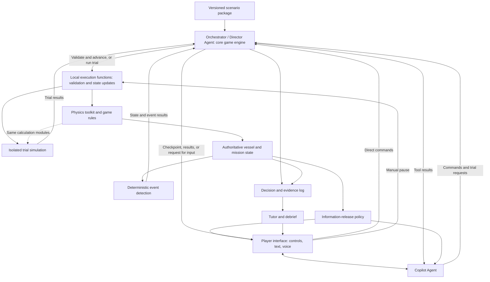

# TIDE: An Agent-Orchestrated Maritime Training Game

## 1. Product Description

### 1.1 Core experience

TIDE is a scenario-based maritime training game. The learner acts as the captain of a specified vessel in a historical marine environment. The learner observes available evidence, adjusts heading and speed, monitors the consequences, and revises the plan as conditions change.

The first mission is **to leave an adverse sea-state region while controlling journey time and game cargo loss**. A continuous vessel state connects successive decisions. The player's actions determine the subsequent trajectory and exposure. The system therefore calculates consequences during play instead of selecting a prewritten branch or marking a single route answer.

The intended experience follows the scenario structure of tactical simulation games: a mission briefing, a bounded operating area, a modelled platform, changing information, meaningful decisions, and a mission outcome. TIDE adapts that structure to maritime observation and decision-making.

### 1.2 Intended learners and educational purpose

The initial audience is deck-officer cadets and nautical-science students who have completed basic navigation, marine meteorology, and introductory ship-stability instruction. 

The exercise targets the application of knowledge:

- Relate wave height, direction, period, and wave systems to the specified vessel and its operating state.
- Distinguish heading, course over ground, speed through water, and speed over ground.
- Identify which information was available at a decision time and whether it needs updating.
- Compare alternative actions and explain their consequences and limitations.
- Monitor the developing situation and revise an earlier decision when appropriate.

[IMO A.893(21)](https://wwwcdn.imo.org/localresources/en/KnowledgeCentre/IndexofIMOResolutions/AssemblyDocuments/A.893%2821%29.pdf) establishes appraisal, planning, execution, and monitoring as connected voyage-planning activities. TIDE concentrates on execution and monitoring, with a briefing and initial plan supplying the earlier context. [IMO MSC.1/Circ.1228](https://wwwcdn.imo.org/localresources/en/OurWork/Safety/Documents/Stability/MSC.1-CIRC.1228.pdf) connects adverse-weather decisions to vessel characteristics, speed, and wave conditions.

### 1.3 Initial scope and success conditions

The prototype uses the S175 motion model with one fixed loading condition and a full-load game cargo template. The template should resemble a plausible container ship without reproducing an exact S175 stowage plan. Loading is not player-configurable in this prototype.

The first release should provide:

1. One  historical adverse-weather window.
2. One fixed vessel loading condition and a documented operating envelope.
3. Continuous movement with heading and speed commands.
4. Manual pauses and event-triggered decision checkpoints.
5. A Copilot that retrieves evidence and compares executable plans.
6. A replay and debrief that trace consequences back to decisions and evidence.

The scenario defines an escape objective, a time budget, and an interpretable cargo-loss mapping. The objective must reward progress as well as exposure reduction. Waiting indefinitely or always using maximum speed must not become a trivial winning strategy.

Escape means leaving the scenario's whole, time-varying adverse-weather region and entering valid waters outside it. A low-wave pocket inside the region does not count. Scenario authors derive and review the region from historical fields before publication; its boundary and completion criteria remain hidden during play. The region follows the frozen environmental timeline, so slower progress can expose the ship to an expanding region.

Escape and cargo loss are assessed separately. Cargo loss does not end the mission; the player can continue trying to escape within the time budget. Cargo grade thresholds remain to be calibrated through worked scenarios.

The current delivery covers game rules, events, the command-line Director loop, and extensible model configuration (PLAN stages 3 and 4). Copilot, Builder, Tutor, and the frontend remain later work.

## 2. Data Sources and Scenario Construction

### 2.1 Three kinds of scenario content

| Content | Meaning | Who may change it? |
| --- | --- | --- |
| Historical environmental reconstruction | Versioned ocean and weather fields for the selected place and period. | Data preparation, before the scenario is published. |
| Authored mission content | Objectives, briefing, instructional prompts, and game rules. | Scenario authors and constrained Agents, within the published rules. |

The weather timeline remains fixed during a session. The player's route through that timeline does not. This distinction provides replayability.

### 2.2 Environmental inputs

| Source or input | Role in the game |   |
| --- | --- | --- |
| Copernicus wave fields | Supply significant wave height, direction, period, and available wind-sea and swell components. |  |
| Copernicus surface-current vectors | Affect position, course over ground, and passage time. |  |
| Appropriate meteorological forecasts | Supply wind and, when needed, gusts, pressure, visibility, or other mission inputs. |  |
| Official marine bulletins, such as AEMET | Provide professional forecast language, warnings, and regional context. |   |

The approximately 4 km regional ocean grid supports bounded open-water exercises. 

Players receive local sea-state observations, their own cargo status, and weather reports for their current and neighbouring sea areas at defined simulation times. Reports carry issue and validity times. Issue time determines when a report becomes available to the Director; the Director can then select its delivery time. Pure local mode delivers reports on the fixed issue schedule. Where historical forecasts are unavailable, the prototype may use forecasts authored offline from historical fields and explicitly labelled as game simulations. These reports are distinct from official historical forecasts; unreleased future fields remain hidden.

### 2.3 Vessel reference package

The leading candidate is the **S175 container-ship dataset in the Marine Systems Simulator (MSS)**. Its [ShipX input report](https://github.com/cybergalactic/MSS/blob/master/HYDRO/vessels_shipx/s175/input.hyd) specifies a 175 m length between perpendiculars, 25.4 m breadth, 9.5 m draft, and a design-waterline loading condition. The [dataset directory](https://github.com/cybergalactic/MSS/tree/master/HYDRO/vessels_shipx/s175) includes hydrodynamic outputs and transfer-function data. MSS provides a [six-degree-of-freedom vessel model](https://github.com/cybergalactic/MSS/blob/master/CRAFT/hydroVessel.m) and a [simulation example](https://github.com/cybergalactic/MSS/blob/master/CRAFT/SIMhydroVessel.m). This is a candidate foundation for one consistent teaching vessel.

### 2.5 Scenario-building workflow

1. **Search historical fields.** Identify candidate windows with relevant changes in wave systems, direction, period, current, or forecast information. Find available scenarios.
2. **Assemble the mission.** Select an initial state and operating area. Generate and review the changing adverse-weather region, cargo template, and timed information releases.
3. **Run numerical trials.** Test representative heading and speed sequences with the same model used during play. Confirm that supported actions produce interpretable tradeoffs. Record at least one model-feasible completion.
4. **Publish a versioned package.** Create Mission Briefing, etc.

A Scenario Builder Agent assists the local scenario-building pipeline by interpreting candidate results, proposing mission settings, invoking validators, reviewing package completeness, and preparing briefings and supporting material. Local code performs data collection, historical scans, numerical trials, and package generation.

## 3. Underlying Physics and Simulation Toolkit

### 3.1 Purpose and module boundaries

The toolkit converts commands and environmental inputs into reproducible vessel consequences. It must capture the effects needed for the exercise with documented accuracy and limitations. TIDE does not need a new CFD solver.

| Module | Responsibility | Main outputs |
| --- | --- | --- |
| Environment sampler | Read fields at the vessel position and time;  | Environmental inputs with provenance and quality flags. |
| Motion and control | Apply heading and speed orders with finite turning and acceleration;  | Position, heading, velocities, and progress. |
| Vessel performance and response | Estimate supported speed loss, motions, or accelerations for the fixed vessel condition. | Vessel-specific response indicators and applicability status. |
| Hazard and exposure | Apply supported criteria and integrate exposure over elapsed simulation time. | Risk flags, accumulated exposure, and explanatory quantities. |
| Numerical integration and event detection | Advance the state and locate relevant changes between decisions. | Updated state, event records, and stopping reasons. |

Geographic validity, missing data, model applicability, and numerical validity apply across these modules. 

Motion simulation and cargo-loss simulation are independently replaceable algorithm modules. The cargo algorithm consumes calculated vessel responses and elapsed simulation time, and returns cargo state and loss events. A common local execution tool advances both consistently; neither algorithm depends on the Director or its model provider.

### 3.2 Practical modelling level

The minimum useful model needs stateful movement, plausible control response, current-driven drift, and vessel-specific consequences that depend on wave conditions, heading, speed, and exposure duration. A constant-speed point following fixed lines is insufficient for this product. Integrate the S175/MSS time-domain dynamics where the data, control model, numerical stability, and runtime cost are demonstrated to be suitable.

A six-degree-of-freedom model can represent surge, sway, heave, roll, pitch, and yaw. The inspected MSS example uses first-order wave excitation and a restoring matrix. 

Retain the full MSS Coriolis coupling. The current implementation adds mean longitudinal wave drift from the same S175 source tables as an external load and uses a fixed logarithmic spectral grid. Do not impose project-defined roll, pitch or vessel-speed cutoffs. The source speed axis describes hydrodynamic table coverage, not a motion or command limit. Keep abnormal motion as simulation output; later ship-damage and cargo-damage rules will define its game consequences. Source-consistent numerical comparison does not establish experimental strong-sea accuracy; environmental coverage, finite-state checks and Euler singularity checks still apply.

Nevertheless, the simulation of ships within the scene remains relatively coarse-grained.

### 3.3 Reusable algorithm 

| Reference | Useful contribution |  |
| --- | --- | --- |
| [MSS S175 and vessel simulation](https://github.com/cybergalactic/MSS/tree/master/HYDRO/vessels_shipx/s175) | A coherent vessel-data candidate and reusable dynamics components. |  |
| [SIMROUTE](https://doi.org/10.1016/j.oceaneng.2022.111427) and its [performance code](https://github.com/ManelGrifoll/SIMROUTE/blob/master/func_simroute.py) | Examples of translating wave fields into empirical speed loss and passage-time calculations. |  |
| [VISIR-2](https://gmd.copernicus.org/articles/17/4355/2024/) | Combines environmental fields, vessel performance, vector currents, and routing objectives. |  |
| [MARIN TopTier](https://www.marin.nl/en/jips/toptier) and its public roll-risk resources | A candidate basis for studying container-ship roll-risk screening. | 

### 3.4 Cargo loss as a game metric

The consequence chain is:

**Sea conditions + vessel state + control history → calculated vessel response → accumulated cargo damage → individual cargo losses.**

Cargo loss provides visible feedback and a mission objective. It does not represent a validated prediction of real container failures. Actual failures depend on stowage, securing, loading, structural response, and other information outside the initial model.

Each cargo unit has a persistent identity and an overboard state. A fixed seed assigns initial vulnerability thresholds; response-driven damage accumulates until a unit's threshold is crossed. One severe motion episode can therefore cause several units to fall overboard. The full-load template distinguishes protected hold cargo from exposed deck cargo, with simple stowage categories rather than detailed lashing mechanics. Lost units cannot be lost again or recover.

The initial template has 800 mixed 20/40-foot units, totalling 1,200 TEU: 320 units on deck and 480 in holds. This is an authored game loading, not a verified S175 cargo manifest. Mild responses may produce zero loss; the algorithm must not force losses merely to make each voyage eventful.

Loss counts and proportions determine the game cargo grade. Loss does not change vessel mass, centre of gravity, or hydrodynamic coefficients in this prototype. TopTier may inform the algorithm's criteria, but it does not supply a calibrated loss-count formula. A separate risk-warning mechanic is not required.

The mapping should satisfy four requirements:

1. Heading and speed changes affect outcomes through the underlying response or risk calculation.
2. Wave period and separate wave systems affect outcomes when the selected method supports them.
3. Loss accumulates with exposure duration, not with the number of checkpoints or LLM calls.
4. Repeating the same inputs and seed reproduces the result.

## 4. Agent-Orchestrated Game Engine

### 4.1 Control architecture

The Orchestrator (Director) Agent is the core game engine: it loads the scenario, receives commands, invokes tools, inspects results, and decides whether to continue or wait for player input. Local execution functions validate commands, maintain authoritative state, and enforce numerical stopping conditions. A separate Session Controller is unnecessary; any controller retained should be a thin execution layer without duplicating the Director's orchestration.

These boxes are responsibilities, not a requirement for separate services or separate language models. One backend can implement them with explicit tool and information boundaries.

### 4.2 Agent responsibilities

| Role | Meaningful actions | Limits |
| --- | --- | --- |
| Scenario Builder | Assist the local pipeline by interpreting candidates, proposing mission settings, invoking checks, and preparing scenario-package material. | Cannot manufacture historical fields or approve professional validity by itself. |
| Orchestrator / Director (Core Game Engine) | Run the game loop, receive commands, select and invoke tools, inspect results, and continue or pause for player input. | Cannot change physical results, force an accident, or execute an unapproved player manoeuvre. |
| Copilot |  interpret requests and apply instructions, assist according to the game settings          | Cannot access hidden future fields or silently take command. |
| Personalized Tutor | Examine evidence use, decisions, stated reasons, revisions, and assistance; generate specific debriefs and propose follow-up exercises. |  /|

The Director provides dynamic, extensible orchestration with the aim of reducing custom game-flow and branch logic. Physics, event detection, and state updates remain local tools. The Director calls them for each game-advance segment, rather than at every numerical integration step, to limit model-call overhead.

The prototype targets a fast, relatively small model, such as Nemotron 3.5 Lightning 30B A3B. It follows explicit procedures and a restricted tool set. It receives player information, cargo events, authoritative mission results, and already-issued report candidates for the current and neighbouring sectors. It cannot access hidden region boundaries, cargo vulnerability thresholds, unissued reports, or raw future environmental fields. It cannot invent events, alter player heading or speed, or override tool results.

The planned Director implementation uses a small LangGraph workflow for tool orchestration, player decision checkpoints, and recovery. Continuous simulation and immediate pause remain local execution responsibilities. Graph recovery must not repeat a committed game advance.

An extensible `models.json` selects provider, model, and generation settings for named Agent profiles. NVIDIA NIM is the default provider; OpenRouter is selected manually. API keys belong in a local JSON configuration excluded from version control. Only the Director role is implemented in the current delivery. Persistent model or tool-call failures fall back to the deterministic local workflow for the current step. The fallback never repeats committed advancement or overrides a player pause. Local-engine mode is the default and runs the same game without model calls or API credentials. Director mode is explicitly enabled for experiments.

### 4.3 Event-driven progression

1. The Director loads the frozen scenario and presents the briefing and initial information.
2. The player sets target heading and speed. The command remains active until changed; the player does not supply an advance duration.
3. The Director calls local tools to validate the command against vessel capability, geographic bounds, and scenario permissions.
4. The Director invokes local advancement under the active command. The player can adjust the game-time rate or pause to revise the command.
5. Mandatory cargo, mission and validity stops pause locally. A separate background Director review chooses when to deliver issued reports and whether current evidence warrants player attention. Simulation continues during that review and pauses only if the resulting attention request passes local validation.
6. The player can keep or revise the command, then explicitly resume. Ordinary internal simulation segments do not require a new player decision.
7. The Director repeats the tool-driven loop from the current state.

Cargo-grade increases and terminal/validity conditions are mandatory local checkpoints. Weather-report importance is evidence for the Director rather than an automatic pause trigger. The Director may defer delivery, publish without stopping, or request an evidence-backed attention pause; pure local mode leaves weather-related pauses to the player. Individual cargo losses update the displayed status without a separate first-loss interruption. Local code detects triggers and enforces mandatory stops. The Director uses only issued reports and current observations, with a review interval, stale-result rejection and pause cooldown. It cannot generate weather changes or override player control.

Trigger persistence and deduplication should prevent repeated interruptions for the same event. A maximum internal advance interval preserves observability and responsiveness without imposing turn-based play.

Sessions record player commands, released evidence, tool calls, events, and outcomes, and support saving and resuming after exit. Saved state preserves wave continuity, cargo vulnerabilities and accumulated damage, and consumed events. Time scaling changes playback pace without changing the simulated consequences.

### 4.4 Plans and branching

The game does not require authors to enumerate every future branch. A command changes state. A conditional plan changes which command should become active when a supported condition holds. Subsequent environmental sampling follows the new trajectory.

Later Copilot work may translate a request into a bounded plan containing heading or waypoint targets, speed targets, duration or completion conditions, and pause conditions. Deterministic checks then establish whether the plan is executable. The current command-line prototype uses persistent heading and speed controls.

[WhatELSE, CHI 2025](https://arxiv.org/abs/2502.18641) provides a design reference for author-controlled narrative spaces and runtime generation of executable events. TIDE adapts that idea to an instructional decision space. This is a proposed transfer, not evidence that WhatELSE validates maritime physics or learning outcomes.

[LLM-Modulo](https://arxiv.org/abs/2402.01817) provides a complementary architectural reference: generated proposals interact with external model-based checks. In TIDE, an Agent can propose and revise a plan, while tools establish its supported consequences and constraints.

## 5. Game Interaction with a Copilot Agent

### 5.1 Player workspace

The main workspace combines:

- A map with the vessel, recent track, intended path, operating boundaries, and selectable environmental layers.
- Instruments showing time, heading, course, speeds, relevant sea-state components, and supported response indicators.
- A mission panel showing the time budget, and game cargo status.
- Direct heading and speed controls, game-time rate and pause/resume controls, and later voice commands through Copilot.

The interface should connect environmental values to the vessel's location and expected arrival times. Encounter diagrams, response plots, and exposure timelines are more useful than an undifferentiated set of raw map layers. Model outputs, forecasts, observations, and game indicators need distinct labels.

An evidence-credit budget remains an optional game experiment. It is not part of the core training requirement. Any later use must explain what resource constraint it represents and how it affects the learning objective.

### 5.2 Direct commands and natural-language commands

The player can issue precise orders through controls or ask the Copilot to construct a command from a broader intention.

Before the frontend and Copilot exist, the entire prototype must be playable from the terminal. The game uses a fullscreen live terminal UI as its only interactive mode. The live screen displays coordinates, vessel state, target and actual heading/speed, local sea conditions, released weather briefings, cargo status, and game time. Players enter target heading and speed manually and can pause at any time without waiting for an Agent. The motion model executes turning, acceleration and deceleration continuously rather than instantly setting the vessel state.

The Copilot retrieves the applicable evidence and vessel constraints, proposes executable commands, and calls the Director to run trial simulations and continue game process. 

Copilots ability can be extended (configured) according to the game settings (difficulty), for example, it can support giving recommendations (so the Copilot should have basic marine knowledge)

## 6. Extensibility and Proposed Contributions

### 6.1 Model and scenario extensions

Institutions can improve physical fidelity without redesigning the whole interaction loop if modules expose clear inputs, outputs, units, state, supported events, and applicability limits. 

### 6.4 Proposed contributions and required evidence

The contribution is the integrated training loop: historical marine information becomes vessel-specific consequences, actionable choices, and traceable learning evidence. 

| Proposed contribution | Concrete system capability |   |
| --- | --- | --- |
| Data accessibility through action | Learners turn sourced fields and forecasts into vessel-specific comparisons and decisions. |  |
| Agent-assisted scenario construction | A Builder assists local search, validation, and packaging code by interpreting results and preparing mission settings, briefings, and supporting material. |  |
| Agent-orchestrated game engine | A Director runs the game through reusable local tools, reducing custom flow and branch logic while supporting new scenarios and tool capabilities. |  |
| Open interaction with verifiable consequences | Text or voice plans become supported command sequences  |  |
| Reusable institutional infrastructure | Versioned scenarios, model modules, and teaching strategies can be reviewed and adapted. |  
